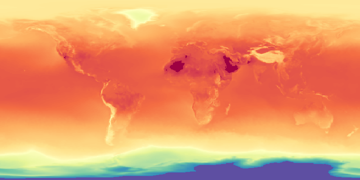

<div align="center">


# Earth in Sound

### Hear Earth change.

Explore NASA climate records through sound, maps, and music.<br>
Start with the planet. Find your city. Listen a little closer.

[Explore the project](https://googoomuck44.github.io/earth-in-sound/) · [Run locally](#run-locally) · [Our data](#our-data) · [Build with us](#build-with-us)

</div>

---

Climate records tell a story. We want more people to be able to follow it.

Earth in Sound turns NASA data into notes you can explore in your browser. Follow global temperature through time, hear the poles in stereo, or listen to the seasons in Dhaka and other cities. A chart moves with the sound, so you can connect each note to its value.

Built for NASA Space Apps, with students, teachers, and curious listeners in mind. No account, backend, or API key is needed for the sources this app uses.

## Pick a view

| View | What you can explore |
| --- | --- |
| **Planet** | Global temperature anomalies since 1880. Warmer years play higher, brighter notes. |
| **Poles** | Arctic, tropical, and Antarctic records on one scale, with three voices placed across your headphones. |
| **My Place** | Monthly temperature, rain, and sunlight since 2001. Search for a city or choose a saved one. |
| **Compare** | Two cities, one in each ear, on one shared temperature scale over the months they share. |
| **Events** | NASA's recent natural-event feed, with category sounds and west-to-east stereo placement. |
| **Scan** | Sweep across NASA maps of air temperature, sea temperature, and vegetation—or explore an image of your own. |

<p align="center">
  
  <br>
  <sub>A saved NASA GIBS air-temperature map used by Scan. This is source imagery, not an app screenshot.</sub>
</p>

## Your first listen

Press **Take a listen** for a one-minute guided listen: the planet, the poles, then three years of Dhaka. Pause, skip, replay or leave at any time. Turn on **Voice** under the player's More button (the sliders icon) to hear the captions read aloud.

Or explore on your own:

1. Open **Planet** and press **Play**.
2. Watch the year and value follow the notes. Drag the timeline or the chart to jump.
3. Try **Poles** with headphones.
4. Open **My Place** and choose **Dhaka**, or a city you know.
5. Pick a **Range** to hear a decade or a single year.
6. Use **Compare** to put two cities in your left and right ears.
7. Open **Data** for the source, units and a CSV, or **Share** to send the same setup.

Change the sound or speed, or record a single pass to save. Sound choices apply to Planet, My Place, and Scan; Poles, Compare and Events use their own fixed voices.

## Run locally

Install **Node.js 22.12 or newer**, then:

```bash
git clone https://github.com/GooGooMuck44/earth-in-sound.git
cd earth-in-sound
npm ci
npm run dev
```

Open the local address Vite prints in your terminal. The repository includes saved data, so a fresh NASA download is optional.

Already have the repo? Run `npm ci` once after dependency changes, then `npm run dev`.

## How it sounds

| Data | What you hear |
| --- | --- |
| Temperature | Higher values become higher notes. |
| Rain | Wetter months add more falling notes. |
| Sunlight | Brighter months open the sound's filter. |
| Polar regions | Three distinct voices: Arctic left, Tropics centre, Antarctic right. |
| Natural events | Fires crackle, storms and volcanoes drum, ice rings. Longitude sets stereo position. |
| Map scan | Values across the image become notes as the scan moves west to east. |

The main pitch mappings use a C major pentatonic scale. Each note is a designed translation of a data value.

Each view uses one fixed pitch scale for its whole record, so choosing a shorter range keeps the same notes. Poles puts all three regions on one scale. **Compare** puts both cities on one shared °C scale across the months they both have, so the same note means the same temperature in either ear. Listening to two cities one after another in My Place does **not** compare them, because each city has its own scale. Busy event days are thinned to 16 sounds; the chart and CSV keep the full count. Missing values are skipped, never played as zero.

## Our data

| Source | What it brings | Keep in mind |
| --- | --- | --- |
| [NASA GISTEMP v4](https://data.giss.nasa.gov/gistemp/) | Global and zonal temperature records | Anomalies in °C relative to **1951–1980**. |
| [NASA POWER](https://power.larc.nasa.gov/docs/services/api/temporal/monthly/) | Local temperature, precipitation, and sunlight | The AG response uses **°C**, **mm/day**, and **MJ/m²/day**. Rain is a mean daily rate, not a monthly total. |
| [NASA EONET v3](https://eonet.gsfc.nasa.gov/docs/v3) | Recent tracked natural events | A dated event feed, not a complete disaster census or evidence of climate causation. |
| [NASA GIBS](https://nasa-gibs.github.io/gibs-api-docs/) | Earth imagery and colour legends | Values inferred from rendered colours are approximate. Uploaded images use colour and brightness, not scientific measurements. |
| [Open-Meteo](https://open-meteo.com/en/docs/geocoding-api) | Place search | Geocoding is provided under CC BY 4.0. |

Saved climate files include their source and retrieval time. POWER files also retain parameter units and API metadata. The downloader checks annual records and requires at least 24 usable months across all three POWER parameters before replacing a saved city file.

## Ready for patchy Wi-Fi

After a complete first online visit to a production build, the app caches its interface and bundled data for offline use.

Saved cities: **Dhaka, New York, London, Lagos, Delhi, Kathmandu, Tokyo, São Paulo, and Sydney**.

New place searches and fresh downloads need a connection. Previously saved places may still work offline. If the app substitutes a nearby saved city, it names that city. Clearing browser site data removes local copies.

## Made for more ways to explore

Use the chart, listen to the notes, or inspect the selected values. Playback starts when you choose it.

| Key | Action |
| --- | --- |
| **Space**, outside a control | Play or pause |
| **← / →**, outside a control | Step through the track; hold **Shift** to move 10 steps |
| **← / →**, on a track tab | Change tracks |
| **Home / End**, on a track tab | Select the first or last track |
| **Tab** | Move between controls |
| Timeline slider | Arrow keys step through time; the slider announces date and value |

Controls include keyboard support, visible focus, and status messages. We still need feedback from people using different devices and assistive technologies; these features are not a claim of completed accessibility certification.

**Recording:** one pass, saved as WebM where the browser supports it. No microphone access is needed. Playback and sharing support vary by browser, especially on Safari and iOS.

## Build with us

The app uses **TypeScript · Vite · Tone.js · uPlot**.

```bash
npm test       # Unit tests, NASA data checks, production build, and offline simulation
npm run build  # TypeScript check and production files in dist/
```

See the [developer guide](docs/DEVELOPMENT.md) for data refreshes, deployment, backup setup, and manual checks. Submission drafts are in [docs/PROJECT.md](docs/PROJECT.md) and demo scripts in [docs/DEMO.md](docs/DEMO.md).

Want to help? Try a saved city, test a keyboard flow, check a source, or tell us where a sound is hard to understand. Include your browser and the steps that led to the issue.

## New in this version

- **Take a listen:** a short guided listen with captions taken from the data.
- **Compare:** two cities, one per ear, on one shared scale.
- **Range:** listen to any span of years. The chart, sound, findings and CSV all follow it.
- **Share:** a link that restores the view, cities, range, sound and speed without autoplay. Links that hold your location say so first.
- **Data:** the dataset, source link, units, coverage, retrieval date, baseline, live or saved status, a limitation, and a CSV download.
- **Findings:** one or two results calculated from the selected data, with ties shown.
- **Saved setups:** keep up to eight named listening setups on this device and restore them later. Setups using a precise current location are not saved.

## Next listens

These are ideas, not shipped features:

- **Then / Now:** hear equal historical periods side by side.
- **Mix:** isolate temperature, rain, and sunlight.
- **Learn:** small classroom activities, with English and Bangla support.

[Testing notes](docs/TESTING.md) list what was checked and what still needs people and devices.

## Our team

We are four fifth-semester students from the **Department of Software Engineering, University of Dhaka**, building Earth in Sound together.

- **Nafisa Usrat**
- **Prottasha Saha Ayoishee**
- **Fahmida Munni**
- **Miti Ara Ferdousi**

## Credits

Our thanks to NASA GISS, the NASA Langley POWER Project, NASA EONET, and NASA GIBS/ESDIS for the data and imagery, and Open-Meteo for place search. Tone.js and uPlot make the browser sound and charts possible. The Manrope typeface (SIL Open Font License) is bundled through Fontsource. The Earth-and-wave mark is our own.

Earth in Sound is a team project built using public NASA data. NASA has not endorsed this app.

Vercel deployment settings and automatic updates are described in the [developer guide](docs/DEVELOPMENT.md#vercel).
